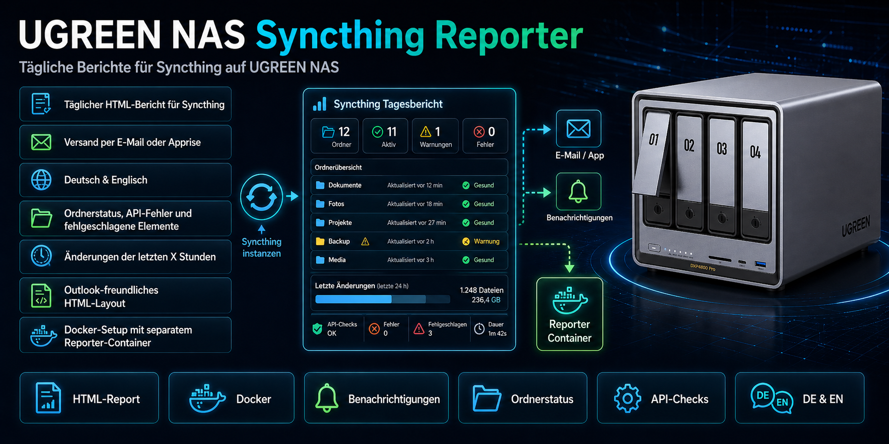

# UGREEN NAS Syncthing Reporter

[](https://github.com/Railsimulatornet/UGREEN-NAS-Syncthing-Reporter/actions/workflows/docker-publish.yml)
[](https://github.com/Railsimulatornet/UGREEN-NAS-Syncthing-Reporter/actions/workflows/codeql.yml)
[](LICENSE)



[Deutsch](#deutsch) · [English](#english)

## Deutsch

Der Syncthing Reporter erstellt täglich einen HTML-Bericht zu deinen Syncthing-Ordnern und versendet ihn über SMTP oder Apprise. Das Docker-Paket ist für UGREEN NAS mit UGOS vorbereitet und kann auch auf anderen passenden Docker-Hosts eingesetzt werden.

### Funktionen

- Ordnerstatus, API-Fehler und fehlgeschlagene Elemente in einem Bericht
- Änderungen der letzten Stunden über `WINDOW_HOURS` auswerten
- Deutsche oder englische Berichte über `REPORT_LANG=de` beziehungsweise `en`
- Outlook-freundliches HTML und lokal gespeicherte Berichte
- Vorgebautes Reporter-Image und eine zusätzliche Variante für lokale Builds
- Automatische Image-, Laufzeit- und Trivy-Prüfungen; Dependabot für Abhängigkeiten und Workflows

### Voraussetzungen

- Docker mit Docker Compose oder die UGOS-Docker-App
- Ein Linux-Host mit AMD64 für das vorgebaute Reporter-Image
- Passende Datei- und Ordnerrechte für `PUID` und `PGID`
- Erreichbare Syncthing-API sowie SMTP- oder Apprise-Zugang für den Versand

Die mitgelieferte Compose-Datei startet **Syncthing und den Reporter**. Prüfe vor der Bereitstellung die Datenpfade und die Portbelegung deiner vorhandenen Installation.

### Schnellstart

1. Lade das Paket unter [Releases](https://github.com/Railsimulatornet/UGREEN-NAS-Syncthing-Reporter/releases/latest) herunter oder verwende den Repository-Inhalt.
2. Kopiere den vollständigen Ordner `syncthing` auf dein NAS oder deinen Docker-Host.
3. Lege im Projektordner die Konfiguration an. Eine vorhandene `.env` bleibt erhalten:

```bash
cd syncthing
test -f .env || cp .env.example .env
```

4. Passe `.env` und die Ordnerfreigaben in `docker-compose.yaml` an. `/volume1/Public` ist ein Beispielpfad.
5. Starte das Projekt im gleichen Ordner:

```bash
docker compose pull
docker compose up -d
docker compose ps
```

In UGOS kannst du stattdessen unter **Docker → Projekt → Erstellen** den Ordner `syncthing` auswählen, die vorhandene Compose-Datei importieren und das Projekt bereitstellen.

### Konfiguration

Alle Einstellungen sind in [syncthing/.env.example](syncthing/.env.example) auf Deutsch und Englisch beschrieben.

| Einstellung | Beispiel | Bedeutung |
| --- | --- | --- |
| `REPORT_LANG` | `de` oder `en` | Sprache des Berichts |
| `SYNCTHING_URL` | `http://syncthing:8384` | Adresse der Syncthing-API |
| `ST_API_KEY` | leer | Wenn leer, liest der Reporter den Schlüssel aus der eingebundenen `config.xml` |
| `PUID` / `PGID` | `1000` / `10` | Benutzer und Gruppe für den Dateizugriff |
| `TZ` | `Europe/Berlin` | Zeitzone |
| `RUN_AT` | `09:45` | Tägliche Ausführungszeit |
| `WINDOW_HOURS` | `24` | Zeitfenster für Änderungen |
| `PRUNE_DAYS` | `14` | Aufbewahrung erzeugter HTML-Anhänge in Tagen |
| `REPORT_HOSTNAME` | `Backup-NAS` | Anzeigename im Bericht |
| `SMTP_HOST`, `SMTP_PORT`, `SMTP_USER`, `SMTP_PASS` | eigene SMTP-Daten | Mailserver und Anmeldung |
| `SMTP_FROM` / `SMTP_TO` | eigene Mailadressen | Absender und Empfänger |
| `SMTP_STARTTLS` / `SMTP_SSL` | `1` / `0` | STARTTLS oder direkte TLS-Verbindung passend zum Mailserver |
| `APPRISE_ENABLED` | `0` oder `1` | Apprise-Versand aktivieren |
| `APPRISE_URL` | eigene HTTP-Notify-URL | Adresse des Apprise-Dienstes; zusätzliche Ziele sind über `APPRISE_URLS` möglich |
| `REPORTER_IMAGE` | `ghcr.io/railsimulatornet/ugreen-nas-syncthing-reporter:latest` | Verwendetes Reporter-Image |

Der Reporter ruft Apprise und SMTP unabhängig voneinander auf. Für ausschließlich SMTP setzt du `APPRISE_ENABLED=0`; für ausschließlich Apprise lässt du `SMTP_HOST` leer. Die Syncthing-Konfiguration wird unter `/st-config` schreibgeschützt eingebunden; Berichte und Cache liegen unter `/state`.

### Aktualisierung

Aktualisiere das bestehende Projekt aus seinem Projektordner:

```bash
cd syncthing
docker compose pull
docker compose up -d
```

Für das Reporter-Image steht außerdem dieser Helfer bereit:

```bash
sh scripts/update_reporter.sh
```

In UGOS: **Neu bereitstellen** und **Das neueste Image abrufen** aktivieren. Behalte deine `.env`, angepassten Freigaben und vorhandenen Daten.

Der UGOS-Projektname kann vom Ordnernamen abweichen. Verwende bei SSH-Aufrufen den Namen aus dem Container-Label `com.docker.compose.project` mit `docker compose -p NAME`. Für die Hilfsskripte kannst du denselben Namen über `COMPOSE_PROJECT_NAME` setzen.

#### Image-Tags und Version

| Tag | Bedeutung |
| --- | --- |
| `2.2.3` | Fester Release-Stand |
| `2.2` / `2` | Folgen neuen Releases ihrer Versionsreihe |
| `latest` | Aktueller geprüfter Build |
| `2.2.3-build.20261018.26.1` | Beispiel eines Wartungsbuilds mit Datum, Lauf- und Wiederholungsnummer |

Der Image-Pfad bleibt `ghcr.io/railsimulatornet/ugreen-nas-syncthing-reporter`. Wöchentliche Wartungsbuilds aktualisieren `latest`, ohne feste Release-Tags zu überschreiben. Der Quellstand steht in `org.opencontainers.image.revision`. Vorhandene `sha-…`-Tags bleiben erhalten; neue werden nicht mehr erzeugt.

Paketstand: **Reporter V2.2.3**, Builddatum **2026-10-18**. Eine neue `VERSION` kann beim Push auf `main` nach erfolgreichen Prüfungen einen GitHub-Release mit ZIP, DE/EN-Handbuch und Prüfsummen auslösen. Titel und Text kommen aus `.github/release-title.txt` und `.github/release-notes.md`. Geplante und manuelle Wartungsbuilds erstellen keinen neuen Release; bestehende Release-Dateien bleiben erhalten.

#### Lokaler Build

Verwende für eigene Anpassungen die separate Build-Konfiguration:

```bash
cd syncthing
docker compose -f docker-compose.local-build.yaml build --pull --no-cache syncthing_reporter_py
docker compose -f docker-compose.local-build.yaml up -d
```

Alternativ baut der Helfer zuerst das neue Reporter-Image und erstellt den Dienst erst nach erfolgreichem Build neu:

```bash
sh scripts/rebuild_reporter_local.sh 2.2.3
```

Ohne Versionsargument verwendet er die Paketversion. Er funktioniert auch, wenn nur der Projektordner `syncthing` kopiert wurde. Bei einem fehlgeschlagenen Build bleibt der bisherige Container erhalten.

### Kontrolle und Fehlersuche

Die Reporter-Ausgabe findest du im Docker-Protokoll:

```bash
docker logs -f syncthing_reporter_py
```

Prüfe bei API-Fehlern `SYNCTHING_URL`, den API-Schlüssel und die eingebundene `syncthing/config/config.xml`. Prüfe bei Versandfehlern den gewählten Versandweg und die SMTP- beziehungsweise Apprise-Daten.

Für lokale Trivy-Berichte im Projektordner:

```bash
sh scripts/security_scan_reporter.sh
```

Die Dateien liegen anschließend unter `syncthing_reporter_py/state/security/`. Das Skript erstellt JSON- und Textberichte; werte auch die enthaltenen Funde aus.

### Projektstruktur

| Pfad im Repository | Inhalt |
| --- | --- |
| `syncthing/.env.example` | Konfigurationsvorlage |
| `syncthing/docker-compose.yaml` | Projekt mit vorgebautem Reporter-Image |
| `syncthing/docker-compose.local-build.yaml` | Variante für lokale Builds |
| `syncthing/scripts/` | Helfer für Update, Neubau und Sicherheitsscan |
| `syncthing/syncthing/config/` | Persistente Syncthing-Konfiguration |
| `syncthing/syncthing_reporter_py/` | Reporter-Code und Dockerfile; `state/` entsteht beim Betrieb |

### Dokumentation

- [Ausführliches Handbuch Deutsch/Englisch](UGREEN_Syncthing_Reporter_Handbuch_DE-EN.pdf)
- [Beispielbericht](Screens/DE_Mail.jpg) und [mobile Ansicht](Screens/DE_MailMobil.jpg)
- [Änderungsverlauf](CHANGELOG.md)

### Lizenz

[MIT License](LICENSE) · Copyright Roman Glos 2026.

## English

Syncthing Reporter creates a daily HTML report about your Syncthing folders and sends it through SMTP or Apprise. The Docker package is prepared for UGREEN NAS with UGOS and can also run on other compatible Docker hosts.

### Features

- Folder status, API errors and failed items in one report
- Changes within the last hours, selected through `WINDOW_HOURS`
- German or English reports through `REPORT_LANG=de` or `en`
- Outlook-friendly HTML and locally saved reports
- Prebuilt reporter image and a separate configuration for local builds
- Automated image, runtime and Trivy checks; Dependabot for dependencies and workflows

### Requirements

- Docker with Docker Compose, or the UGOS Docker app
- A Linux AMD64 host for the prebuilt reporter image
- Appropriate file and directory permissions for `PUID` and `PGID`
- Access to the Syncthing API and SMTP or Apprise credentials for delivery

The supplied Compose file starts **Syncthing and the reporter**. Check the data paths and port assignments of your existing installation before deploying it.

### Quick start

1. Download the package from [Releases](https://github.com/Railsimulatornet/UGREEN-NAS-Syncthing-Reporter/releases/latest), or use the repository files.
2. Copy the complete `syncthing` directory to your NAS or Docker host.
3. Create the configuration in the project directory. An existing `.env` is preserved:

```bash
cd syncthing
test -f .env || cp .env.example .env
```

4. Adjust `.env` and the folder mounts in `docker-compose.yaml`. `/volume1/Public` is an example path.
5. Start the project from the same directory:

```bash
docker compose pull
docker compose up -d
docker compose ps
```

In UGOS, you can instead open **Docker → Project → Create**, select the `syncthing` directory, import its Compose file and deploy the project.

### Configuration

All settings are documented in German and English in [syncthing/.env.example](syncthing/.env.example).

| Setting | Example | Purpose |
| --- | --- | --- |
| `REPORT_LANG` | `de` or `en` | Report language |
| `SYNCTHING_URL` | `http://syncthing:8384` | Syncthing API address |
| `ST_API_KEY` | empty | If empty, the reporter reads the key from the mounted `config.xml` |
| `PUID` / `PGID` | `1000` / `10` | User and group for file access |
| `TZ` | `Europe/Berlin` | Time zone |
| `RUN_AT` | `09:45` | Daily execution time |
| `WINDOW_HOURS` | `24` | Time window for changes |
| `PRUNE_DAYS` | `14` | Retention of generated HTML attachments in days |
| `REPORT_HOSTNAME` | `Backup-NAS` | Display name in the report |
| `SMTP_HOST`, `SMTP_PORT`, `SMTP_USER`, `SMTP_PASS` | your SMTP details | Mail server and authentication |
| `SMTP_FROM` / `SMTP_TO` | your email addresses | Sender and recipient |
| `SMTP_STARTTLS` / `SMTP_SSL` | `1` / `0` | STARTTLS or implicit TLS, matching your mail server |
| `APPRISE_ENABLED` | `0` or `1` | Enable Apprise delivery |
| `APPRISE_URL` | your HTTP notify URL | Apprise service address; additional destinations can be set through `APPRISE_URLS` |
| `REPORTER_IMAGE` | `ghcr.io/railsimulatornet/ugreen-nas-syncthing-reporter:latest` | Reporter image to use |

The reporter calls Apprise and SMTP independently. For SMTP only, set `APPRISE_ENABLED=0`; for Apprise only, leave `SMTP_HOST` empty. The Syncthing configuration is mounted read-only at `/st-config`; reports and cache are stored under `/state`.

### Updating

Update the existing project from its project directory:

```bash
cd syncthing
docker compose pull
docker compose up -d
```

This helper is also available for the reporter image:

```bash
sh scripts/update_reporter.sh
```

In UGOS, choose **Redeploy** and enable **Download the latest image**. Keep your `.env`, customized mounts and existing data.

The UGOS project name may differ from the directory name. For SSH commands, use the name from the container label `com.docker.compose.project` with `docker compose -p NAME`. You can pass the same name to the helper scripts through `COMPOSE_PROJECT_NAME`.

#### Image tags and version

| Tag | Meaning |
| --- | --- |
| `2.2.3` | Fixed release |
| `2.2` / `2` | Follow new releases in their version series |
| `latest` | Current verified build |
| `2.2.3-build.20261018.26.1` | Example maintenance build with date, run number and attempt number |

The image path remains `ghcr.io/railsimulatornet/ugreen-nas-syncthing-reporter`. Weekly maintenance builds update `latest` without overwriting fixed release tags. The source revision is recorded in `org.opencontainers.image.revision`. Existing `sha-…` tags are retained; new ones are no longer created.

Package version: **Reporter V2.2.3**, build date **2026-10-18**. After successful checks, pushing a new `VERSION` to `main` can create a GitHub release with a ZIP, the DE/EN handbook and checksums. Its title and text come from `.github/release-title.txt` and `.github/release-notes.md`. Scheduled and manual maintenance builds do not create a new release; existing release files are preserved.

#### Local build

Use the separate build configuration for your own changes:

```bash
cd syncthing
docker compose -f docker-compose.local-build.yaml build --pull --no-cache syncthing_reporter_py
docker compose -f docker-compose.local-build.yaml up -d
```

Alternatively, the helper builds the new reporter image first and recreates the service only after a successful build:

```bash
sh scripts/rebuild_reporter_local.sh 2.2.3
```

Without a version argument, it uses the package version. It also works when only the `syncthing` project directory was copied. If the build fails, the existing container is preserved.

### Checks and troubleshooting

Read the reporter output in the Docker log:

```bash
docker logs -f syncthing_reporter_py
```

For API errors, check `SYNCTHING_URL`, the API key and the mounted `syncthing/config/config.xml`. For delivery errors, check the selected delivery method and your SMTP or Apprise settings.

To create local Trivy reports from the project directory:

```bash
sh scripts/security_scan_reporter.sh
```

The files are written to `syncthing_reporter_py/state/security/`. The script creates JSON and text reports; review the findings they contain as well.

### Project structure

| Repository path | Contents |
| --- | --- |
| `syncthing/.env.example` | Configuration template |
| `syncthing/docker-compose.yaml` | Project using the prebuilt reporter image |
| `syncthing/docker-compose.local-build.yaml` | Local build configuration |
| `syncthing/scripts/` | Update, rebuild and security scan helpers |
| `syncthing/syncthing/config/` | Persistent Syncthing configuration |
| `syncthing/syncthing_reporter_py/` | Reporter code and Dockerfile; `state/` is created during operation |

### Documentation

- [Detailed German/English handbook](UGREEN_Syncthing_Reporter_Handbuch_DE-EN.pdf)
- [Example report](Screens/DE_Mail.jpg) and [mobile view](Screens/DE_MailMobil.jpg)
- [Changelog](CHANGELOG.md)

### License

[MIT License](LICENSE) · Copyright Roman Glos 2026.
